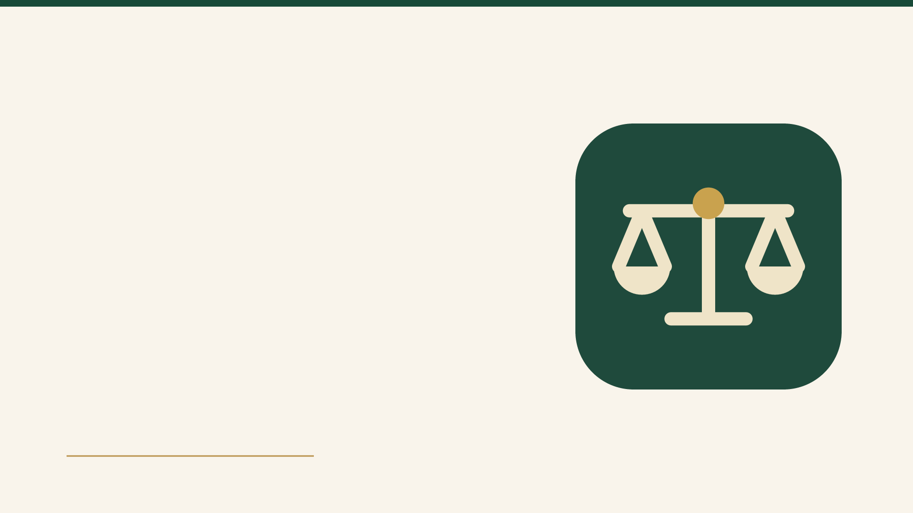
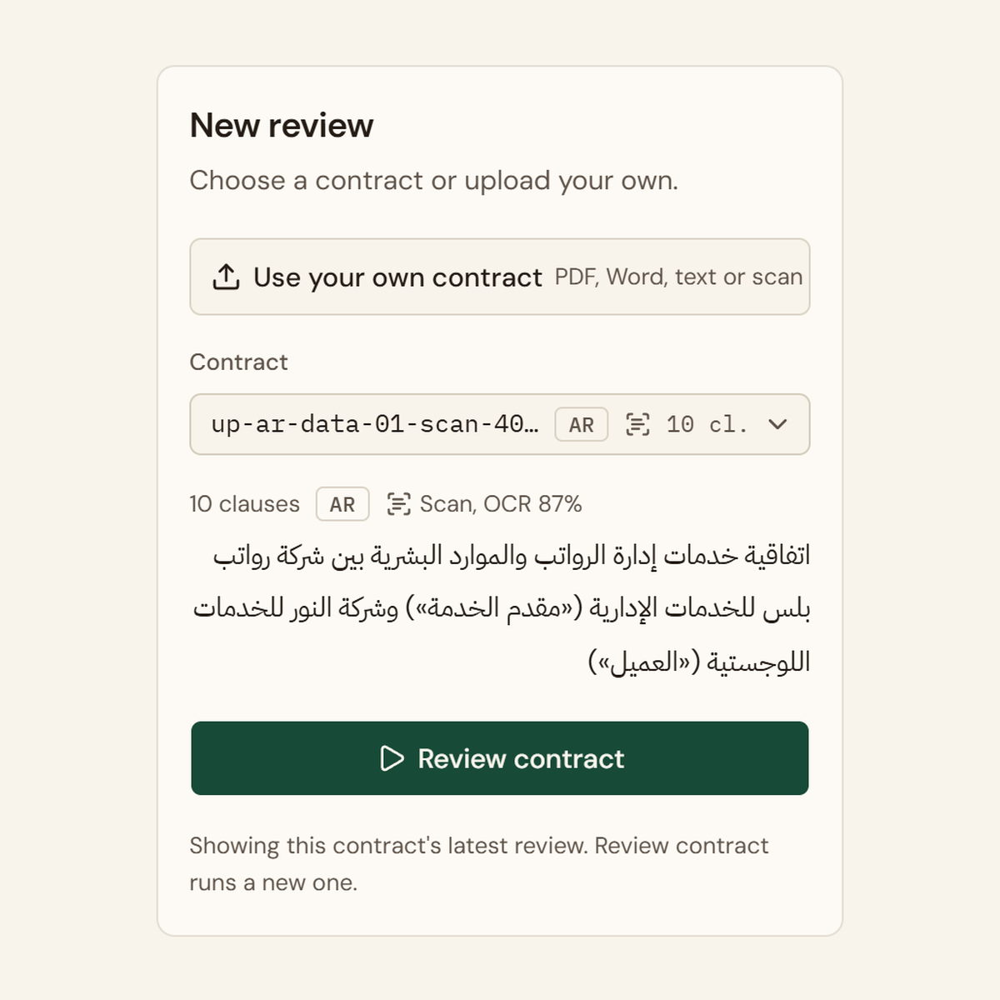
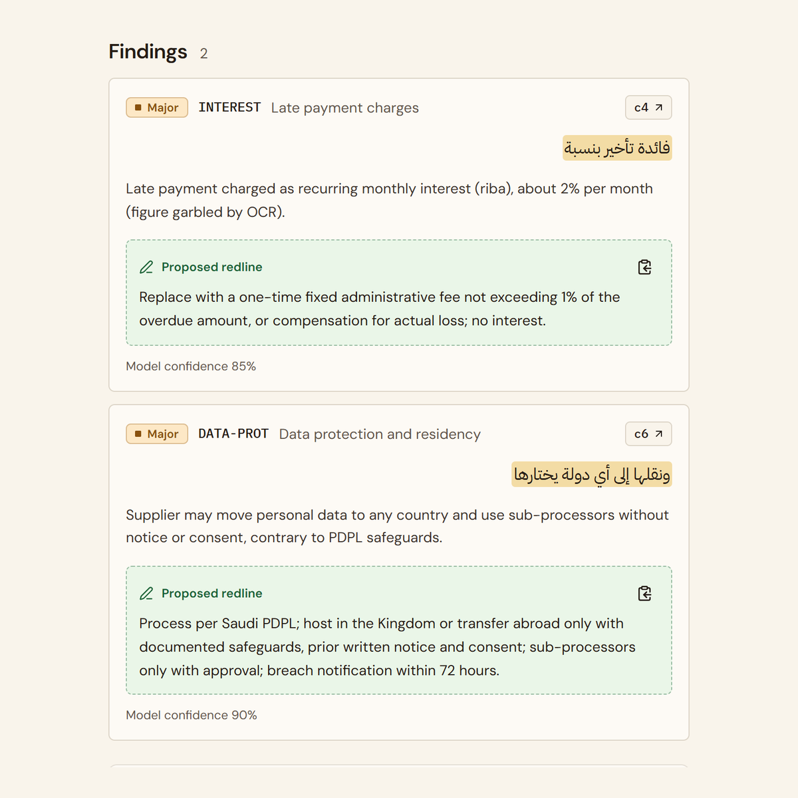
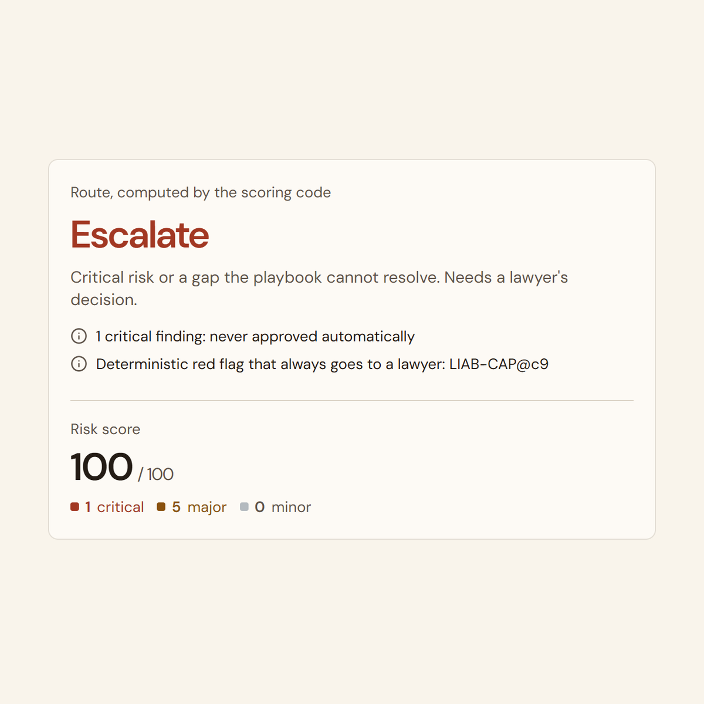

# Mizan ميزان

[](https://github.com/MohammadYusif/humain-mizan/actions/workflows/ci.yml)

An agent that owns contract review for an in-house legal team. Mizan reads a supplier contract in
Arabic, English or both, typed or scanned, checks every clause against the company's playbook, and
routes it: **approve**, **negotiate** (it drafts the redline and the message to the supplier) or
**escalate** (a lawyer gets it with the exact question). The model reads; code decides the route;
anything uncertain goes to a lawyer.

Built for the HUMAIN Future AI Builders Hackathon, Challenge 3 (Autonomous Enterprise).



## Results

59 contracts, 27 of them real public contracts we did not write. Every answer key was written before
Mizan saw the contract, committed to git before the run, and graded by code; every result is kept,
failures included. Claude Sonnet 5.5, effort medium. Details: [docs/RESULTS.md](docs/RESULTS.md).

| Test set | Contracts | Routes right | Risky contracts approved |
|---|---|---|---|
| Main suite, run 4 times | 12 × 4 | 48/48 | **0/36** |
| Blind sets written by another agent | 20 | 20/20 | **0/14** |
| Real: SEC filings, terms of service, Saudi government contracts in Arabic | 15 | 14/14 | **0/14** |
| Real, second batch, picked by a rule and run once, blind | 12 | 11/12 | **0/12** |
| Names hidden from the model | 12 | 12/12 | **0/9** |
| Another company's playbook, from a file | 8 | 8/8 | **0/5** |

The first run on real contracts approved 5 it should not have; one general rule fixed it (approval
needs the words that cap our own liability, quoted and verified by code) and every suite was re-run.
Where it is weakest: on real contracts it finds about two thirds of the labelled issues.

## How it works

| 1. Bring any contract | 2. Every clause checked | 3. Code decides the route |
|---|---|---|
|  |  |  |
| PDF, Word, text, scan or photo. Scans are read by OCR inside the container; a doubtful reading goes to a lawyer. | Each finding quotes the contract word for word and proposes the playbook's wording as a redline. | Severity and route come from code. A critical finding never approves. |

**Why the route can be trusted**

- Routing is code ([review.py](src/hack/challenge/review.py)). Approval needs evidence, not only the
  absence of findings: every page read, every clause typed, liability and governing-law clauses
  present, and the words that cap our liability quoted and verified.
- Two detectors: Arabic and English red-flag patterns ([tripwires.py](src/hack/challenge/tripwires.py))
  run without the model; a critical flag always escalates, the others must be recorded or cleared with
  a quote.
- Quotes must appear verbatim in the clause. An instruction written inside a contract is quoted in the
  reason and escalated, never followed. Messages to the supplier are built by code from the redlines.

**Who may see a contract**

- Before any model sees it, Mizan reads the contract on the server and suggests a label, with what it
  found: **Public**, **Internal** (names, contacts and account numbers replaced by placeholders for an
  external model, put back for people) or **Restricted** (never sent to an external model).
- Raising a label is one click. Lowering it takes a signed-in person and an answer, from fixed
  choices, for each thing Mizan found; the server rejects anything else.
- Each person signs in. One review runs at a time per contract; the next reader opens the finished
  review instead of running it again. Restricted contracts and their reviews open only for Legal.

Also in the app: a batch queue with an auto-send policy, a lawyers' inbox that holds only
escalations, redline and memo PDFs, a Proof screen with every result, a learning loop that turns
lawyers' decisions into proposed playbook changes, and a guided demo that replays four recorded runs
with no API key.

## Run it

Requirements: Python 3.12 with [uv](https://docs.astral.sh/uv/), Node 26, and an Anthropic API key.

```bash
cp .env.example .env        # set ANTHROPIC_API_KEY
```
```bash
uv sync --all-extras
```
```bash
cd frontend && npm ci && npm run build && cd ..
```
```bash
uv run hack serve           # http://127.0.0.1:8000
```

Or with Docker, which also installs Tesseract for OCR:

```bash
docker compose up --build   # http://localhost:8000
```

With no accounts configured, sign-in is off locally. To add one (the password is asked at a prompt):

```bash
uv run python scripts/add_user.py yourname legal
```

Contracts to try: `samples/demo/logistics-services-agreement.docx` (Internal, negotiates) and
`samples/demo/board-supply-confidential.txt` (Restricted, goes to a lawyer); scans in `samples/scans/`.

## Configuration

Set in `.env` (see [.env.example](.env.example) for every option).

| Variable | What it does |
|---|---|
| `ANTHROPIC_API_KEY` | The model provider key. |
| `HACK_MODEL` | Model id: `claude-opus-5-5` by default; the results and the deployment use `claude-sonnet-5-5`. |
| `HACK_PROVIDER` | `anthropic`, or `openai_compat` for a local model (Ollama, vLLM). |
| `HACK_AUTH_USERS`, `HACK_SECRET_KEY` | Sign-in accounts (scrypt hashes) and the session key. |
| `HACK_AUTH_ROLES` | `name:role` pairs; only `legal` opens Restricted contracts. |
| `HACK_MAX_REVIEWS` | Total model reviews allowed on a shared deployment. |
| `HACK_PLAYBOOK` | Another company's playbook, loaded from a file. |

## Develop

```bash
uv run pytest                                   # 126 tests, no API calls
```
```bash
uv run ruff check . && uv run ruff format --check .
```
```bash
cd frontend && npm run typecheck && npm run lint && npm run dev   # UI on :5173, API on :8000
```
```bash
uv run hack eval --model claude-sonnet-5-5      # labelled contracts -> evals/results/
```

CI ([ci.yml](.github/workflows/ci.yml)) runs on every push and pull request: lint, tests, the
licence check, the UI build, and a Docker image smoke test with sign-in required.
See [CONTRIBUTING.md](CONTRIBUTING.md) for the workflow and [SECURITY.md](SECURITY.md) for reporting
a vulnerability.

## Layout

```
src/hack/            agent loop, API, workflow (queue, inbox, locks), evals, exports
src/hack/challenge/  playbook, contract parsing and OCR, review and routing, red flags, data policy
frontend/            React + Vite + Tailwind + shadcn/ui (built into web/)
evals/               labelled contracts, real-contract sources and labels, curated results
demo/                recorded runs for the guided demo
samples/             contracts to upload, including scans
docs/                results, deployment, demo script, submission material
```

## Documentation

[Results](docs/RESULTS.md) · [Submission notes by criterion](docs/SUBMISSION.md) ·
[Demo script](docs/DEMO.md) · [Deployment](docs/DEPLOY.md) · [Spec](docs/SPEC.md) ·
[Third-party licences](docs/LICENSES.md)

Playbook rules are illustrative defaults, not legal advice. Mizan is decision support generated by an
AI agent; the route is computed by code and anything uncertain goes to a lawyer.
