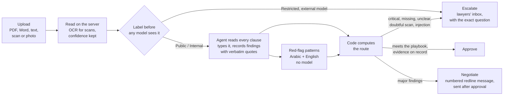
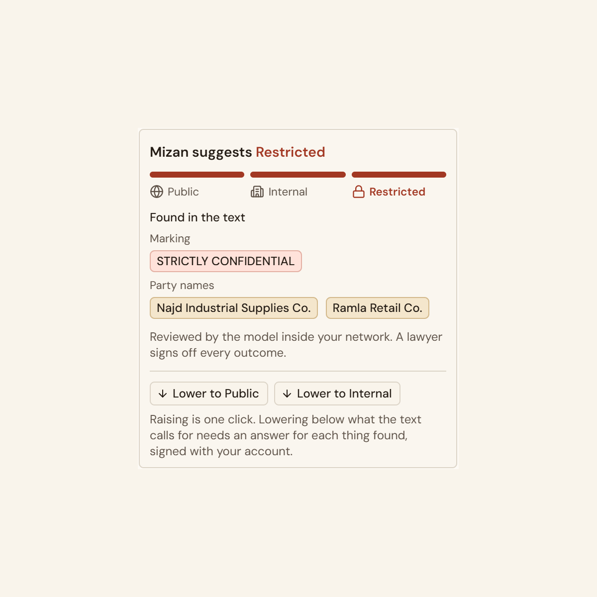
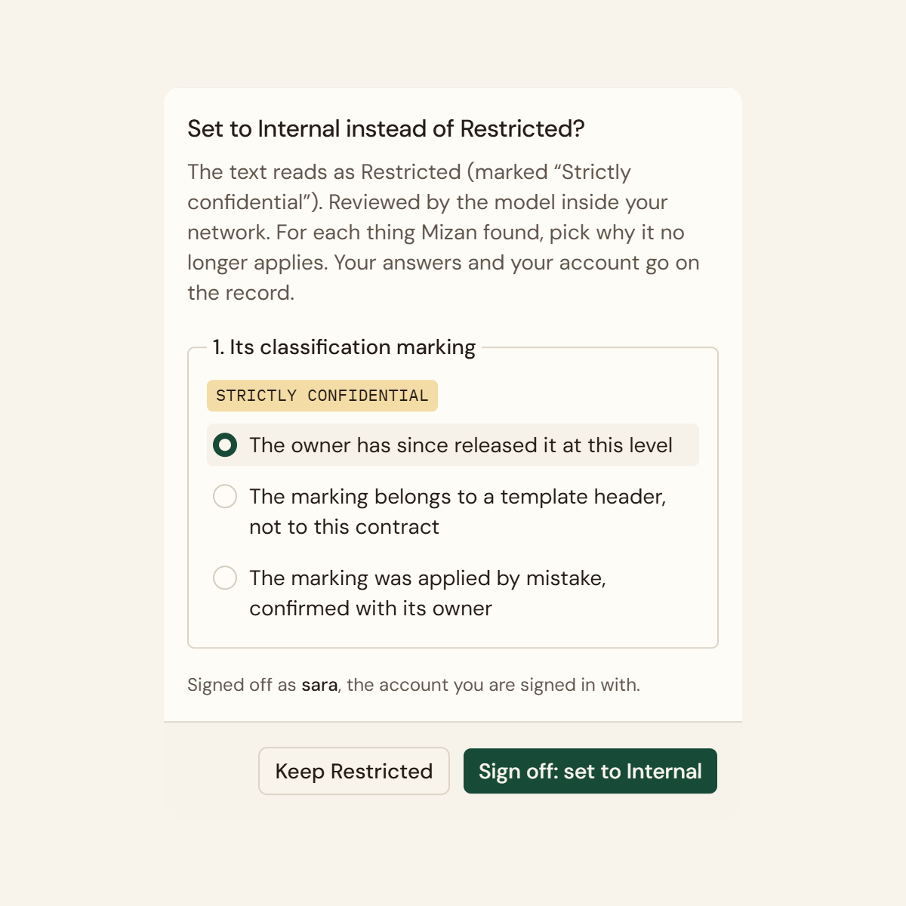
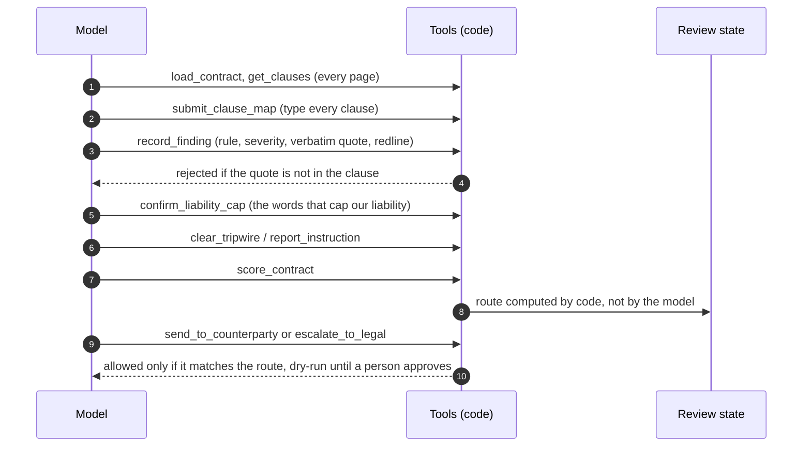
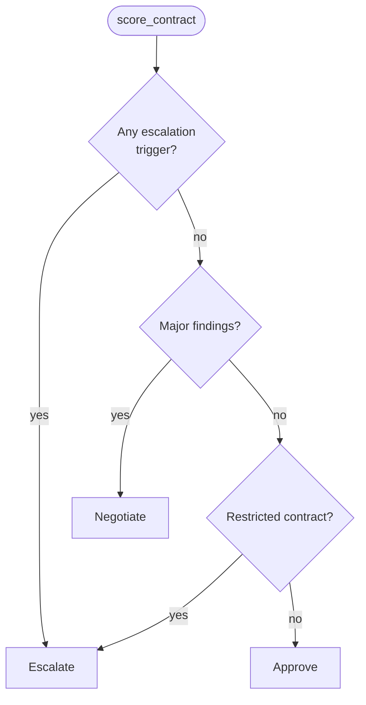
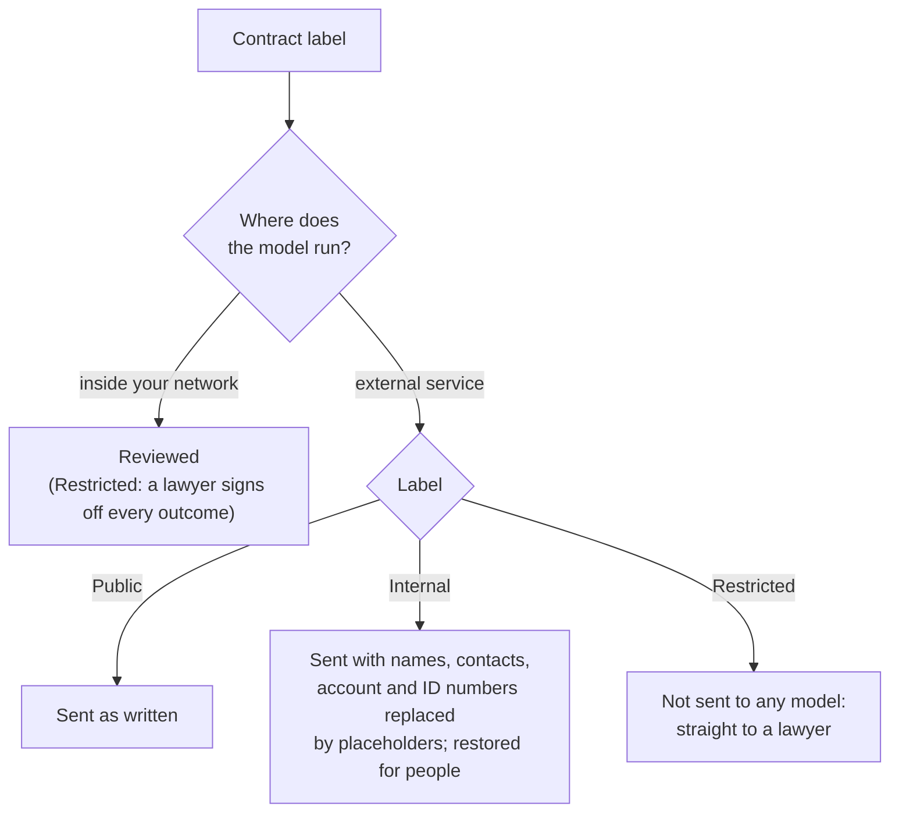
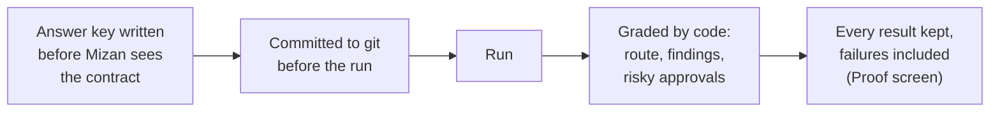
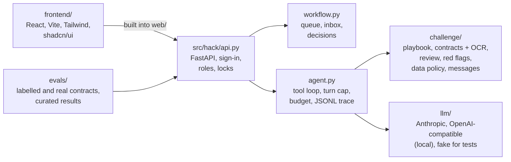

# Mizan ميزان

[](https://github.com/MohammadYusif/humain-mizan/actions/workflows/ci.yml)

An agent that owns contract review for an in-house legal team. Mizan reads a supplier contract in
Arabic, English or both, typed or scanned, checks every clause against the company's playbook, and
routes it: **approve**, **negotiate** (it drafts the redline and the message to the supplier) or
**escalate** (a lawyer gets it with the exact question). **The model reads; code decides the route;
anything uncertain goes to a lawyer.**

Built for the HUMAIN Future AI Builders Hackathon, Challenge 3 (Autonomous Enterprise).

**[Watch the 3-minute demo](https://drive.google.com/file/d/1yabBq7JDDt5jCNAI5LyUffKdqcBwGB2B/view?usp=sharing)** ·
[Slides (PDF)](docs/submission/mizan-deck.pdf) · [Results](docs/RESULTS.md) ·
[Submission notes by criterion](docs/SUBMISSION.md)


## Contents

[What the AI does](#what-the-ai-does) · [How a contract flows](#how-a-contract-flows) · [Results](#results) ·
[How the route is decided](#how-the-route-is-decided) · [Who may see a contract](#who-may-see-a-contract) ·
[How we test](#how-we-test) · [Run it](#run-it) · [Configuration](#configuration) ·
[Develop](#develop) · [Layout](#layout) · [Author](#author)

Built with Claude Sonnet 5.5 (Anthropic SDK), Python 3.12, FastAPI, React, Vite, Tailwind CSS,
shadcn/ui, Tesseract OCR, Typst and Docker.

## What the AI does

Claude does the reading and the judgement, which no fixed rule can do: it reads the contract in
Arabic, English or both, types every clause against the playbook, decides how far each one deviates
and how serious that is, quotes the evidence word for word, finds the words that cap our liability,
drafts the redline, and notices instructions hidden in the text.

On contracts they were not written for, our fixed Arabic and English patterns caught 1 of 13
issues; Claude found 12 of 13. A smaller local model (qwen3:14b) approved 2 of 8 risky contracts
on the same set. The quality of the model's reading is what makes the review useful.

Code has a narrower job: it checks every quote against the contract, keeps the review state and
computes the route from the model's findings. The AI reads and judges; code makes sure nothing is
approved without evidence.

## How a contract flows



Each run writes a JSONL trace; the review page, the redline and memo PDFs and every eval grade are
rebuilt from it. A batch queue runs many contracts in parallel and only escalations reach a lawyer.

| 1. Bring any contract | 2. Mizan labels it first | 3. Every clause checked | 4. Code decides the route | 5. People stay in charge |
|---|---|---|---|---|
|  |  |  |  |  |

## Results

59 contracts, 27 of them real public contracts we did not write. Claude Sonnet 5.5, effort medium.
Details and every failure: [docs/RESULTS.md](docs/RESULTS.md); the app's Proof screen shows the same
runs.

| Test set | Contracts | Routes right | Risky contracts approved |
|---|---|---|---|
| Main suite, run 4 times | 12 × 4 | 48/48 | **0/36** |
| Blind sets written by another agent | 20 | 20/20 | **0/14** |
| Real: US SEC filings, terms of service, Saudi government contracts in Arabic | 15 | 14/14 | **0/14** |
| Real, second batch, picked by a fixed rule and run once, blind | 12 | 11/12 | **0/12** |
| Names hidden from the model | 12 | 12/12 | **0/9** |
| Another company's playbook, from a file | 8 | 8/8 | **0/5** |

The first run on real contracts approved 5 of 14 it should not have; one general rule fixed it
(approval needs the words that cap our own liability, quoted and verified by code) and every suite was
re-run. Where it is weakest: on real contracts it finds about two thirds of the labelled issues.

## How the route is decided

The model works through tools; code checks every call and keeps the state.



The routing rules, exactly as [review.py](src/hack/challenge/review.py) applies them:



Escalation triggers: a critical finding; a finding filed under the wrong clause type; a clause it could
not classify; a missing liability or governing-law clause; no confirmed cap on our liability; a scan
read with low confidence; an instruction aimed at the AI; a major finding with low confidence or no
redline; a critical red flag, or one neither recorded nor cleared.

Approval also needs every page read and every clause typed: `score_contract` refuses to run before
that. An instruction written inside a contract is quoted in the escalation reason, never followed.

## Who may see a contract

Before any model sees a contract, Mizan reads it on the server and suggests a label, showing what it
found. The decision is made per contract, before each run ([policy.py](src/hack/challenge/policy.py)):



- Raising a label is one click. Lowering it takes a signed-in person and an answer, from fixed choices,
  for each thing Mizan found; the server rejects anything else and records who and why.
- Each person signs in. One review runs at a time per contract, and the next reader opens the finished
  review instead of running it again. With roles set, Restricted contracts and their reviews open only
  for Legal, on every endpoint.
- Messages to the supplier are built by code from the redlines, never the model's own wording.

## How we test



Blind sets were written by agents that never saw Mizan's rules or output, and the second real batch
was picked by a fixed rule (`scripts/select_cuad_batch.py`) so nobody chose it. Saved traces can be
re-graded without calling the model (`hack rescore`). 126 automated tests check every guarantee in
code without any API call.

## Run it

Requirements: Python 3.12 with [uv](https://docs.astral.sh/uv/), Node 26, and an Anthropic API key.

```bash
cp .env.example .env        # set ANTHROPIC_API_KEY
```
```bash
uv sync --all-extras
```
```bash
cd frontend && npm ci && npm run build && cd ..
```
```bash
uv run hack serve           # http://127.0.0.1:8000
```

Or with Docker, which also installs Tesseract for OCR:

```bash
docker compose up --build   # http://localhost:8000
```

With no accounts configured, sign-in is off locally. To add one (the password is asked at a prompt):

```bash
uv run python scripts/add_user.py yourname legal
```

Contracts to try: `samples/demo/logistics-services-agreement.docx` (Internal, negotiates) and
`samples/demo/board-supply-confidential.txt` (Restricted, goes to a lawyer); scans in `samples/scans/`.
The Guided demo in the app replays four recorded runs with no API key.

Private deployment: [docs/DEPLOY.md](docs/DEPLOY.md) (Railway, sign-in required, a cap on model reviews).

## Configuration

Set in `.env` (see [.env.example](.env.example) for every option).

| Variable | What it does |
|---|---|
| `ANTHROPIC_API_KEY` | The model provider key. |
| `HACK_MODEL` | Model id: `claude-opus-5-5` by default; the results and the deployment use `claude-sonnet-5-5`. |
| `HACK_PROVIDER` | `anthropic`, or `openai_compat` for a local model (Ollama, vLLM). |
| `HACK_AUTH_USERS`, `HACK_SECRET_KEY` | Sign-in accounts (scrypt hashes) and the session key. |
| `HACK_AUTH_ROLES` | `name:role` pairs; only `legal` opens Restricted contracts. |
| `HACK_MAX_REVIEWS` | Total model reviews allowed on a shared deployment. |
| `HACK_PLAYBOOK` | Another company's playbook, loaded from a file. |

## Develop

```bash
uv run pytest                                   # 126 tests, no API calls
```
```bash
uv run ruff check . && uv run ruff format --check .
```
```bash
cd frontend && npm run typecheck && npm run lint && npm run dev   # UI on :5173, API on :8000
```
```bash
uv run hack eval --model claude-sonnet-5-5      # labelled contracts -> evals/results/
```

CI ([ci.yml](.github/workflows/ci.yml)) runs on every push and pull request: lint, tests, the
licence check, the UI build, and a Docker image smoke test with sign-in required.
See [CONTRIBUTING.md](CONTRIBUTING.md) for the workflow and [SECURITY.md](SECURITY.md) for reporting
a vulnerability.

## Layout



```
src/hack/            agent loop, API, workflow (queue, inbox, locks), evals, exports
src/hack/challenge/  playbook, contract parsing and OCR, review and routing, red flags, data policy
frontend/            React + Vite + Tailwind + shadcn/ui (built into web/)
evals/               labelled contracts, real-contract sources and labels, curated results
demo/                recorded runs for the guided demo
samples/             contracts to upload, including scans
docs/                results, deployment, demo script, submission material
```

Third-party components and their licences: [docs/LICENSES.md](docs/LICENSES.md). Real-contract texts
are not in the repository; only their sources, checksums and labels.

## Author

Mohammad Albeladi, DGExams AI builder and AI trainer at SDAIA Academy and KAUST. The same
evidence-first design runs in [DGExams](https://dgexams.com), which re-answers every exam question and
flags each disagreement, and in the [capstone grader](https://84-8-103-122.sslip.io) used at SDAIA
Academy, where code checks every AI citation against the student's files and holds anything
borderline for a person.

Playbook rules are illustrative defaults, not legal advice. Mizan is decision support generated by an
AI agent; the route is computed by code and anything uncertain goes to a lawyer.
