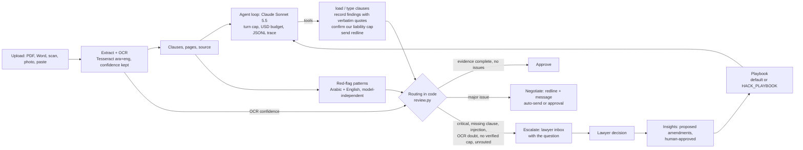

# Mizan: submission notes, by judging criterion

Mizan (ميزان, "balance") owns contract review end to end for a Saudi buyer. It reads a contract in
Arabic, English or both (typed, PDF, Word, scan or phone photo), checks every clause against the
company's playbook, and routes it: **approve**, **negotiate** (it writes and sends the redline), or
**escalate** to a lawyer with the exact question. The model reads and argues; **code decides the
route** and refuses to approve anything it cannot verify.

Every number below is in `evals/proof/` (what the Proof screen shows) and can be re-graded without
model calls (`hack rescore`). Claude Sonnet 5.5, effort medium, unless stated.

## 1. Task performance on unseen cases

| Suite | What it is | Routes right | Wrongly approved | Recall / precision | Cost per contract |
|---|---|---|---|---|---|
| Main | 12 contracts we wrote and tuned on | 12/12 | 0/9 | 100% / 94% | $0.052 |
| Held-out (blind) | 12 contracts by a separate agent that never saw our patterns or labels | 12/12 | 0/8 | 92% / 100% | $0.053 |
| Second blind batch | 8 more, new industries, labels committed (`f1f75c6`) before the only run | **8/8** | **0/6** | 100% / 88% | $0.054 |
| Real contracts | 15 public contracts: CUAD SEC filings, Zoom/Dropbox terms (CLAUDETTE), Saudi Ministry of Finance and EXPRO contracts in Arabic, up to 101 pages, read by OCR | 14/14 | 0/14 | 73% / 97% | $0.23 |

The second blind batch was run once and is reported as it came out. Its one precision miss is an extra
indemnity finding on the colocation contract; every labelled issue and every route matched.

On the real contracts the agent found all 7 issues marked by outside annotators (CUAD's lawyer-reviewed
annotations, CLAUDETTE's unfair-clause tags). The first run on them was blind and was not good; see 3.

## 2. Robustness and adaptation

- **Another company's rules, no code change.** `HACK_PLAYBOOK=evals/policy/other-buyer.json` loads a
  different buyer's playbook (payment no sooner than 60 days, prepayment at most 30%, a supplier exit on
  30 days' notice accepted for 12-month terms). Labels were written from the policy before the run.
  Result: 8/8, and both expected route changes happened (`ar-services-01` approve → negotiate,
  `services-en-01` negotiate → approve), 0/5 wrong approvals. Critical rules cannot be relaxed by a
  policy file.
- **Languages and formats.** Arabic, English and bilingual contracts, including an Arabic/English
  conflict. Scans and photos are read by Tesseract (best Arabic + English models) inside the container.
  Arabic PDFs are always OCR'd because their text layers come out scrambled. A clean Arabic scan
  (87% OCR confidence) routes exactly like the typed original; a blurry photo (64%) escalates.
- **Long, messy real documents.** 79- and 101-page Arabic framework agreements are grouped into about
  130 clauses; pages with no text layer are OCR'd one by one; nothing readable means "unread" and a lawyer.
- **Adversarial text.** A contract that tells the reviewer to approve it is escalated, whether the
  instruction is caught by the pattern check or reported by the model with a verified quote.
- **Weaker models.** A local model (qwen3:14b) goes from 3/9 wrong approvals with no safeguards to 0/9
  with them, on the main suite. On the blind set it still approved 2 of 8 risky contracts, so we say
  plainly: local ("sovereign") mode needs a lawyer on every contract.
- **Confidential contracts.** Every contract carries a label (Public, Internal, Restricted). On upload,
  Mizan reads the text on the server, with no model call, and suggests the label with its reasons: a
  confidentiality marking, an NDA, health records or a card number make it Restricted; names or account
  details, Internal; a blank template, Public. Making it stricter is one click; making it looser is recorded
  as a person's decision, next to what the text called for. Mizan never decides on its own to send
  something out; it only decides on its own to hold something back. Restricted
  contracts never reach an external model: with one configured they go to a lawyer with no model call; with
  a model inside the network they are reviewed but never approved or sent automatically. Internal contracts
  reach an external model with names, contact details, account and ID numbers replaced by placeholders.
  Measured on the main suite with names hidden: 12/12 routes, 0/9 wrong approvals, the same as with them.
- **Learning from lawyers.** Lawyers' decisions in the Inbox become proposed playbook amendments that a
  human accepts or rejects. Critical rules and red flags never relax; demo replays never teach it.

## 3. Evaluation and iteration

Labels always came first: each suite's labels were committed before its first run, by a reviewer that
did not see model output.

| When | Measured | Change | After |
|---|---|---|---|
| Day 1 | qwen3:14b, no safeguards: 58% routes, **3/9 wrong approvals** | Deterministic Arabic + English red-flag patterns, independent of the model | 75%, 0/9 |
| Day 1 | qwen3:14b often stopped with steps left | Completion check: the loop says exactly what is missing (at most twice); unfinished runs go to a lawyer | 92%, 0/9 |
| Day 1 | Blind held-out, first run: 92% routes; missed an Arabic prompt injection (routed negotiate, not escalate) | The model can report an injected instruction with a verified quote, as a second detector. The regex was **not** widened to fit the test wording | 100% |
| Day 1 | Red-flag patterns catch 12/12 on the suite they were written for, **1/13** on the blind set | Reported, not tuned away: on new contracts the model is the real detector | Use a strong model unattended |
| Day 2 | Real contracts, blind first run: 57% routes, **5/14 wrongly approved**. On buyer-side Saudi paper the agent read the *supplier's* uncapped liability as the liability clause, so nothing capped ours | A general gate: approval or negotiation needs the words that cap **our** liability, quoted and verified by code; otherwise escalate | 100%, 0/14 |
| Day 2 | Regression check after that gate | Re-ran main and held-out | 12/12; 100%, 0/8 |
| Day 2 | Policy change; second blind batch | New playbook from a file; 8 new blind contracts | 8/8; 8/8 |

The eval harness measures route accuracy, wrong approvals (the number that matters most), recall and
precision per rule, recall against independent annotators only, latency and cost, and records the
limits each run had (turn cap, budget, effort, playbook). `hack eval --model A --model B` compares
models; `hack rescore` re-grades saved traces against changed labels at no cost, and every rescore is
named in the result.

## 4. Technical judgement and creativity



Decisions and their trade-offs:

- **The model never chooses the route.** It reads, types clauses and records findings; code computes
  severity and route. Cost: the model can't use judgement to approve something borderline. That is
  intended: an unverifiable approval is the expensive error.
- **Approval needs evidence, not the absence of findings.** Every page read, every clause typed,
  liability and governing-law clauses present, the cap on our liability quoted, quotes verbatim in the
  clause. "Found nothing wrong" is not enough. This is what fixed the real-contract failure.
- **Two independent detectors.** Patterns catch known wording cheaply and deterministically; the model
  catches new wording. They must agree, and a critical flag can't be argued away.
- **Local OCR with a confidence gate.** Scans never leave the container, and a doubtful reading
  escalates instead of guessing. The gate is calibrated on three sample scans only (stated in 6).
- **Injection-safe exports.** Redline and memo PDFs are typeset with Typst from data passed as JSON,
  never as markup, so contract text can't inject formatting or code.
- **Where a contract may go is code, not a setting people must remember.** The label is checked before
  the run starts and again in the tool that hands contract text to the model, and every review records
  the label, where the model ran and what it did not see.
- **Demo-safe by design.** Four recorded runs replay as if live with no key or network; they are
  labelled "Replay" and kept out of the learning loop.

## 5. Engineering quality

- Python 3.12 (uv, ruff), FastAPI, React 19 + Vite + Tailwind + shadcn/ui, Docker. One container
  serves the API and the built UI.
- 99 tests with no API calls (scripted fake model): every routing guarantee in 2 and 4 has a test.
- CI on every push (`.github/workflows/ci.yml`), on a fresh clone: lint and format, tests, licence
  check (no GPL/AGPL/LGPL/SSPL), the Proof results load, UI typecheck, lint and build, then a Docker
  build and smoke test with sign-in required (401 before login, 200 after), Arabic OCR present and the
  demo scenes served.
- Every run writes a JSONL trace (`runs/<id>/trace.jsonl`); the review page is rebuilt from it, and
  evals can be re-graded from it.
- Limits on every run: turn cap, USD budget, loop guard (an identical tool call is not repeated a third
  time). Outward sends need approval or an explicit auto-send policy.
- Private deployment ready (Railway, Mizan's own sign-in: scrypt hashes, signed HttpOnly cookie, rate
  limit, fails closed) but **not deployed**. Secrets live only in `.env` / the host's variables.
- Third-party components and their licences: `docs/LICENSES.md`. Real-contract texts are not in git;
  only their sources, checksums and labels.

## 6. Communication

- In the app: **Proof** shows each suite separately with its own question and every contract;
  **Inbox** shows only what needs a person; each review shows the route, the reason, quotes and the
  trace. Demo script: `docs/DEMO.md`.
- Results in full, including what went wrong: `docs/RESULTS.md`.

Limits we state rather than hide: playbook rules are illustrative, not legal advice; most labels are
ours (only 7 real-contract labels come from outside annotators); the real Saudi contracts are all buyer
paper, so approval of a real compliant contract is not tested; risky Arabic contracts are only measured
on synthetic suites (no public labelled source exists); the OCR gate is calibrated on our three sample
scans; handwriting, stamps and signatures are not read; suites are small (8 to 15 contracts), so these
are strong signals, not benchmarks.

## Reproduce every number

```bash
uv sync --all-extras && cp .env.example .env     # add ANTHROPIC_API_KEY
uv run hack eval --model claude-sonnet-5-5                                     # main
uv run hack eval evals/heldout/cases.jsonl --suite held-out
uv run hack eval evals/heldout/cases-batch2.jsonl --suite held-out-2
HACK_PLAYBOOK=evals/policy/other-buyer.json uv run hack eval evals/policy/cases.jsonl --suite policy-change
uv run python scripts/fetch_real_contracts.py                                  # texts, checksum-verified
HACK_BUDGET_USD=4 uv run hack eval evals/real/cases.jsonl --suite real
HACK_SAMPLE_SENSITIVITY=internal uv run hack eval --suite redaction            # names hidden
uv run hack rescore evals/proof/<file>.json --cases <cases.jsonl>              # re-grade, no model calls
```

Model output varies between runs, so a re-run can differ slightly from the saved results; the saved
traces and `hack rescore` reproduce the grading exactly.

## Submission checklist

- [ ] Submitted via the platform's designated channel before the deadline (note time zone); each team member accepted terms
- [ ] Repo private; no .env, keys, brief or datasets committed (`git ls-files | grep -E "\.env|data/"` is empty)
- [x] `uv run pytest` green; `uv run python scripts/check_licenses.py` clean; docs/LICENSES.md complete (CI)
- [x] README: what it does, how to run (`docker compose up --build`), architecture, results, limitations
- [x] `hack eval` results saved (`evals/proof/`) and quoted here and in docs/RESULTS.md
- [ ] Demo video recorded (docs/DEMO.md), no confidential data visible
- [x] Fresh-clone test: CI builds and runs the image from a fresh checkout
- [ ] Nothing submitted gets deleted or altered afterwards
